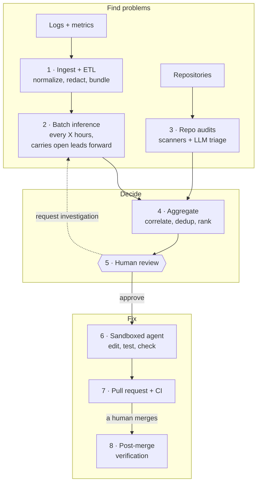
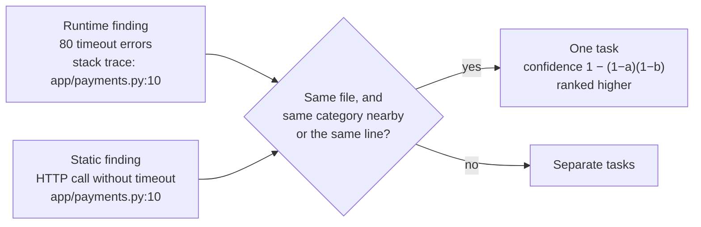
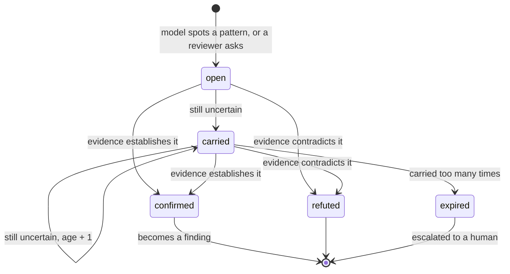
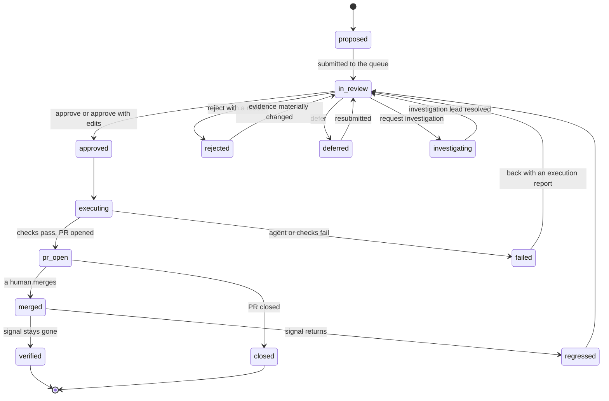
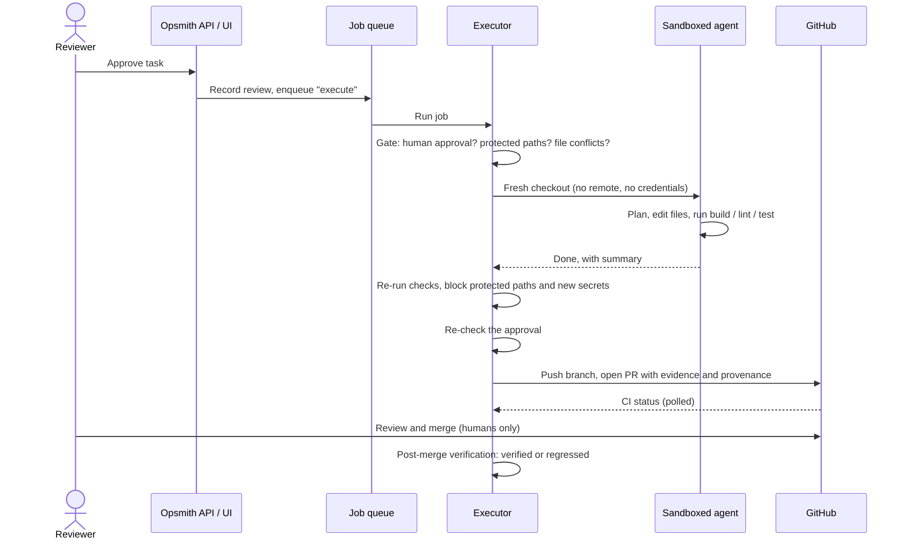
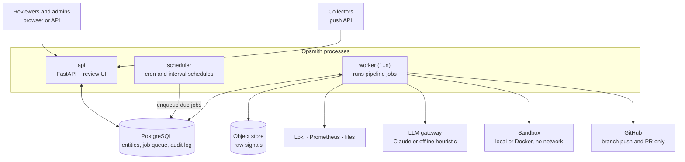

# Opsmith

[](https://github.com/deadboyccc/Opsmith/actions/workflows/ci.yml)
[](LICENSE)

**Opsmith turns production signals and source code into reviewed, ready-to-merge pull requests.**

It watches your logs, metrics and repositories. It finds problems and improvement opportunities
and turns them into ranked engineering tasks. Once a human approves a task, a sandboxed coding
agent implements it and opens a PR.

> **Two rules are never broken:** nothing changes code without a recorded human approval, and
> Opsmith can never merge. A human always merges.

---

## Contents

1. [The big picture](#1-the-big-picture)
2. [Key concepts](#2-key-concepts)
3. [How it works, stage by stage](#3-how-it-works-stage-by-stage)
4. [Lifecycles](#4-lifecycles)
5. [Architecture](#5-architecture)
6. [Quickstart](#6-quickstart)
7. [Configuration](#7-configuration)
8. [Safety model](#8-safety-model)
9. [API and roles](#9-api-and-roles)
10. [Development](#10-development)
11. [Further reading](#11-further-reading)

---

## 1. The big picture

The whole system is one loop: **observe → analyze → propose → human approve → execute → PR**.
It has three phases:

- **Find problems:** automatic and read-only.
- **Decide:** a human is always in the loop.
- **Fix:** happens only after approval.



Rejections feed back too: a rejected task suppresses future duplicates of the same issue
unless the evidence materially changes.

Every arrow is a **queued, idempotent, retried job**. A failure never vanishes: it ends up as a
visible dead job with a notification, or as a task back in the review queue with an
execution report.

---

## 2. Key concepts

Learn these seven terms and the rest of this document follows.

| Concept | What it is | Example |
|---|---|---|
| **Signal** | A normalized, redacted log event or metric point | `ERROR upstream timeout after 30000ms` |
| **Bundle** | A compact, LLM-sized summary of one service over one time window: log templates and metric anomalies, with pointers to the raw data | 80 timeout errors, p95 latency up 590% |
| **Lead** | An open question carried from one analysis run to the next until it is confirmed, refuted or expired | "Timeouts are recurring. Confirm next window." |
| **Finding** | A confirmed problem with evidence, from inference (runtime) or an audit (static) | `httpx.post` without timeout at `app/payments.py:10` |
| **Task** | One or more correlated findings, ranked P0–P3, with an approach and acceptance criteria | "Add a timeout to the payment gateway call" |
| **Review** | A human decision on a task, recorded with identity and time | approved by *Riley Reviewer* |
| **Execution run** | One sandboxed attempt to implement an approved task and open a PR | branch `opsmith/performance/…`, PR #1 |

The link from code back to evidence is always traceable:
**PR → execution run → review → task → findings → evidence (bundles, raw events, audit results) → pipeline runs → leads.**

---

## 3. How it works, stage by stage

| # | Stage | What happens | Produces |
|---|---|---|---|
| 1 | **Ingest + ETL** | Connectors pull or receive signals. They are parsed, normalized, enriched with service and repo ownership, and **redacted** (PII and secrets). Similar log lines are grouped into templates; metrics get baselines, deltas and anomaly flags. | Raw JSONL in object storage, plus **bundles** |
| 2 | **Batch inference** | Every *X* hours per service, the model reads the new bundles **plus the open leads from the last run**. It confirms, refutes or carries each lead and reports new findings and leads. | **Findings**, updated **leads**, an immutable run record |
| 3 | **Repo audits** | On a schedule (full or changed files only): secrets, Python bug, security and N+1 checks, dependency CVEs (OSV), licenses, policy-as-code, test gaps, and external scanners when installed. An LLM pass filters false positives. | **Findings** with code locations |
| 4 | **Aggregate** | Findings from both sources are merged when they point at the same code (higher confidence), deduplicated against open, recently closed and rejected tasks, then scored and ranked. | Ranked **tasks** in the review queue |
| 5 | **Human review** | A reviewer approves, approves with edits, rejects (with a reason), defers, or asks for more investigation. | A recorded **review** |
| 6 | **Execute** | An isolated agent checks out the repo, edits files, and runs build, lint and test. Opsmith re-runs the checks itself and blocks unsafe diffs. | A tested commit on a new branch |
| 7 | **Pull request** | Opsmith pushes the branch and opens a PR that carries the evidence, the checks run, the risk, and links back to the task. | A **PR**; CI status is tracked |
| 8 | **Verify** | After a human merges, Opsmith watches the original signal: still gone means `verified`, back again means `regressed`. | The final task status |

### How runtime and code evidence meet

The strongest tasks combine *what production shows* with *what the code shows*:



### How duplicates and rejections are handled

| A new finding matches… | Result |
|---|---|
| an **open** task | Its evidence is added to that task; no new task is created |
| a task **closed or merged in the last 14 days** | Suppressed |
| a **rejected** task | Suppressed unless the evidence *materially* changed: higher severity, a new kind of evidence, or 2–3× stronger evidence, depending on the rejection reason |
| nothing | A new task is created and sent for review |

---

## 4. Lifecycles

### Lead lifecycle

Leads keep context between analysis runs. Each run sees only a *summary* of open leads, never
the full history, so the context stays bounded.



### Task lifecycle



### From approval to pull request



---

## 5. Architecture

Three process types share one database. Scale workers horizontally; the scheduler is safe to
run more than once because each schedule slot is enqueued exactly once.



**Technology:** Python 3.12, FastAPI, SQLAlchemy 2, Pydantic 2, PostgreSQL (SQLite for
development), the official Anthropic SDK, and uv. The reasons behind each choice are in
[`ARCHITECTURE_DECISIONS.md`](ARCHITECTURE_DECISIONS.md).

### Code map

| Path | Responsibility |
|---|---|
| `src/opsmith/platform.py` | Wires every component together. Start reading here. |
| `connectors/`, `etl/` | Signal sources; normalize, redact, store, bundle |
| `inference/` | Chained analysis runs with lead carry-over |
| `audits/` | Analyzers and the audit runner |
| `aggregation/` | Correlation, dedup, scoring, task drafting |
| `review.py` | The human review gate |
| `executor/` | Sandbox, coding agents, diff gates, PR body |
| `scm/` | GitHub and local git providers (no merge operation) |
| `tracking.py` | PR/CI tracking and post-merge verification |
| `llm/` | The gateway every model call goes through, prompts, pricing |
| `queue.py`, `scheduler.py` | Durable job queue and schedules |
| `api/`, `ui/` | REST API and server-rendered UI |

---

## 6. Quickstart

### Option A: Offline demo (about 5 seconds, no API key)

The fastest way to see the entire loop.

```bash
uv sync --all-extras
uv run opsmith demo --dir ./opsmith-demo
```

What you will see:

1. **Run 1:** an error burst becomes open **leads**.
2. **Run 2:** the timeout lead is **confirmed** using context carried from run 1, and a latency
   regression is found.
3. **Audit:** finds a missing HTTP timeout on the same line as the runtime errors, and the two
   **merge into one task**.
4. A reviewer **approves** it, the agent fixes it, and the checks pass.
5. A **PR** opens with local CI, a human merges it, and the task ends **`verified`**.

Then explore the result in the UI:

```bash
OPSMITH_DATA_DIR=./opsmith-demo/data uv run opsmith api
# open http://127.0.0.1:8000/ui and sign in with the admin key the demo printed
```

### Option B: Full stack with Docker Compose (PostgreSQL)

```bash
docker compose up -d --build                                              # api, worker, scheduler, postgres
docker compose exec api opsmith init --tenant acme --admin "Your Name"    # prints an API key (shown once)
docker compose cp opsmith.example.toml api:/tmp/opsmith.toml
docker compose exec api opsmith apply /tmp/opsmith.toml --tenant acme     # projects, repos, connectors
```

Open <http://localhost:8000/ui> and sign in with the key.

### Option C: Local development

```bash
uv sync --all-extras
uv run opsmith init --tenant dev     # prints an API key
uv run opsmith run                   # api + scheduler + worker in one process (development only)
```

---

## 7. Configuration

Configuration has two layers:

| Layer | Where | Examples |
|---|---|---|
| **Process settings** | `OPSMITH_*` environment variables ([`.env.example`](.env.example)) | database URL, data directory, sandbox backend, provider allowlist |
| **Project settings** | Per project, editable in the UI, the API, or a TOML file | analysis interval, budgets, protected paths, models per stage, notifications, policy rules |

Apply project configuration declaratively. Re-applying is safe, because records are upserted
by name:

```bash
opsmith apply opsmith.toml --tenant acme      # see opsmith.example.toml for every option
```

A minimal `opsmith.toml`:

```toml
[[projects]]
name = "payments"

[projects.settings]
inference_interval_hours = 6          # "X": per-service overrides are allowed

[[projects.repositories]]
name = "payments-api"
scm_provider = "github"
url = "https://github.com/acme/payments-api.git"
full_name = "acme/payments-api"
credentials_ref = "env:GITHUB_TOKEN"  # a reference, never the secret itself
test_command = "pytest -q"

[[projects.services]]
name = "payments-api"
repository = "payments-api"

[[projects.connectors]]
name = "loki"
type = "loki"
service = "payments-api"
config = { url = "http://loki:3100", query = '{service_name="payments-api"}' }
```

> **Secrets are never stored.** Configuration holds references only: `env:NAME` or
> `file:/path`.

### Turning on Claude

The default `heuristic` provider is deterministic and works offline. To use Claude, install the
`anthropic` extra, set `ANTHROPIC_API_KEY`, and choose models per stage:

```toml
[projects.settings]
executor_agent = "claude"                 # let Claude implement approved tasks

[projects.settings.llm.default]           # analysis, triage, task drafting
provider = "anthropic"
model = "claude-opus-5-5"
effort = "medium"

[projects.settings.llm.stages.executor]   # the coding agent
provider = "anthropic"
model = "claude-opus-5-5"
effort = "high"
```

---

## 8. Safety model

| Guarantee | How it is enforced |
|---|---|
| **No code change without a human approval** | The executor checks for a reviewer or admin approval before the run and again just before opening the PR |
| **No autonomous merge** | The SCM interface has no merge operation at all |
| **Redaction before any LLM call** | Signals are redacted during ingestion and redacted again in the LLM gateway |
| **Prompt-injection hardening** | Logs and code are marked as untrusted data; model output must match a schema; unknown IDs and invented evidence are discarded |
| **Least privilege** | Connectors are read-only; the agent has no shell, network or Git credentials; Opsmith only pushes branches (never the default branch) and opens PRs |
| **Sandbox isolation** | `local`: scrubbed environment and timeouts. `docker`: `--network none`, all capabilities dropped |
| **Protected paths** | `elevated` paths (CI config, auth code) need an admin approval with explicit acknowledgement; `excluded` paths are never changed |
| **Budgets** | Token and cost caps per run and per project per day; time and iteration caps for agents |
| **Full audit trail** | Every state change and decision is logged; analysis runs are immutable and record their prompt and model versions |

---

## 9. API and roles

Interactive OpenAPI docs are served at `/docs`. Authenticate with
`Authorization: Bearer <api key>`.

| Role | Can do |
|---|---|
| `viewer` | Read everything in their tenant |
| `reviewer` | Review tasks (approve, edit, reject, defer, investigate) |
| `admin` | Configure projects, retry dead jobs, approve protected-path changes |
| `service` | Push signals (`POST /api/v1/connectors/{id}/push`) |

Most-used endpoints:

| Purpose | Endpoint |
|---|---|
| Configure | `POST /api/v1/projects` · `…/repositories` · `…/services` · `…/connectors` · `PATCH …/settings` |
| Review queue | `GET /api/v1/projects/{id}/tasks?status=in_review` |
| Decide | `POST /api/v1/tasks/{id}/review` |
| Trace a PR | `GET /api/v1/tasks/{id}/provenance` |
| Pipeline state | `…/leads` · `…/findings` · `…/inference-runs` · `…/audit-runs` · `…/executions` · `…/summary` |
| Operations | `POST …/trigger` · `GET /api/v1/jobs` · `POST /api/v1/jobs/{id}/retry` · `GET /healthz` · `GET /metrics` |

All data is tenant-scoped. Other tenants' resources respond with `404`.

---

## 10. Development

```bash
uv sync --all-extras     # install everything
make check               # what CI runs: ruff, format check, mypy, tests with coverage
uv run pytest -q         # tests only (add -k <expr> to target)
uv run pytest tests/test_e2e.py   # the spec's acceptance criteria, end to end
make docker-test         # run the checks inside Docker (no local Python needed)
```

CI runs the same checks, repeats the acceptance tests on PostgreSQL, and builds the container
images.

Contributing, or an AI coding agent? Read [`AGENTS.md`](AGENTS.md) first. It lists the
invariants that must never be broken and the conventions the codebase follows.

---

## 11. Further reading

| Document | Read it for |
|---|---|
| [`docs/SPECIFICATION.md`](docs/SPECIFICATION.md) | The original product specification |
| [`ARCHITECTURE_DECISIONS.md`](ARCHITECTURE_DECISIONS.md) | Why each design choice was made, the alternatives, and known limitations |
| [`AGENTS.md`](AGENTS.md) | Contributor and AI-agent guide: commands, invariants, conventions |
| [`opsmith.example.toml`](opsmith.example.toml) | Every project configuration option, annotated |

## License

[MIT](LICENSE)
