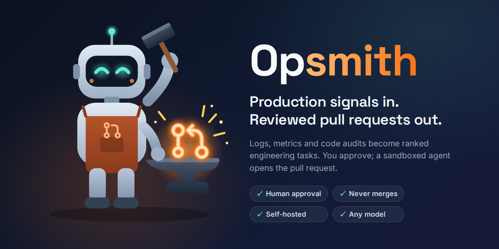
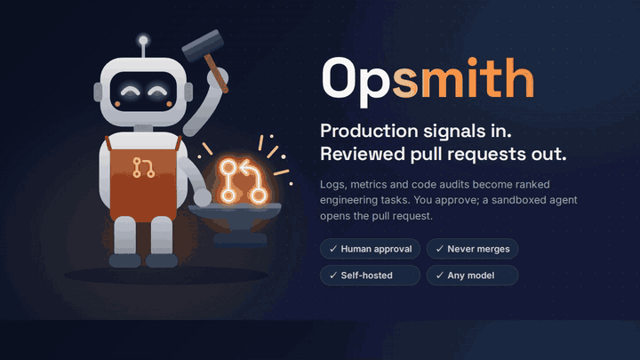
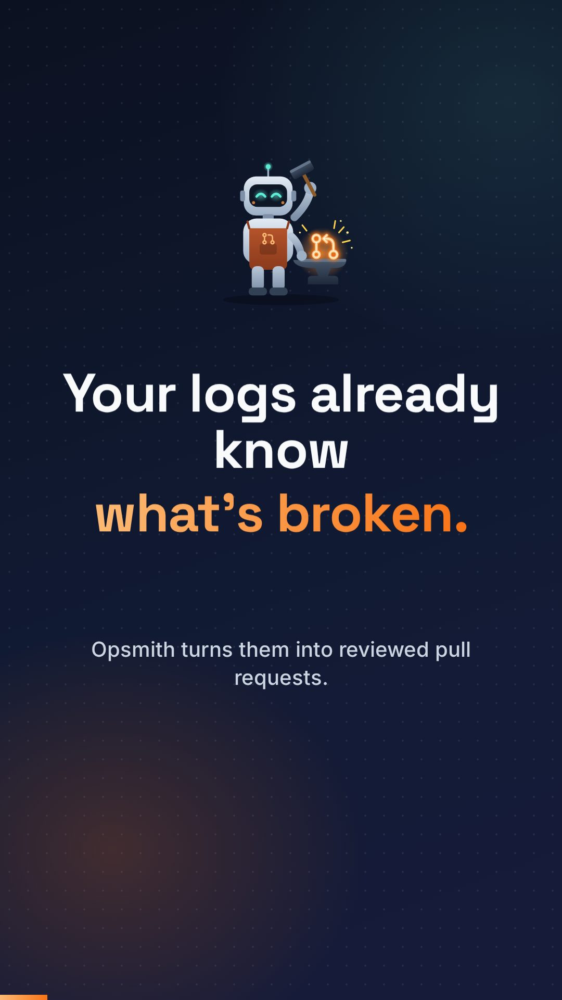
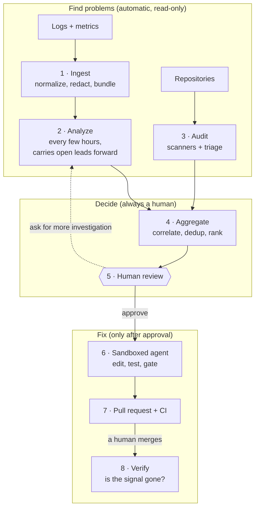

<p align="center">
  
</p>

# Opsmith

[](https://github.com/deadboyccc/Opsmith/actions/workflows/ci.yml)
[](https://github.com/deadboyccc/Opsmith/releases/latest)
[](LICENSE)

**Opsmith turns production signals and source code into reviewed pull requests.**

It watches your logs, metrics and repositories, links what production shows to what the code
shows, and ranks the result as engineering tasks. When a human approves a task, a sandboxed
coding agent implements it and opens a pull request. After a human merges it, Opsmith checks
that the original problem is actually gone. You can also give it review instructions of your
own, such as "audit this code for bugs and performance issues", which a model carries out on
a schedule you choose ([checks](docs/guide/checks.md)).

It is self-hosted and not tied to a model vendor: it runs offline with built-in rules, with
Claude, or with any OpenAI-compatible endpoint, including local models served by Ollama or
vLLM.

> **Two rules are never broken.** Nothing changes code without a recorded human approval, and
> Opsmith cannot merge. A human always merges.

**Status: stable, not yet proven in production.** Releases follow semantic versioning; see the
[latest release](https://github.com/deadboyccc/Opsmith/releases/latest) and the
[changelog](CHANGELOG.md). The whole loop runs and is covered by tests, including adversarial
ones and real-container sandbox tests. See [what has been tested](#what-has-been-tested) before
you point it at something valuable.

## Contents

- [See it work in a minute](#see-it-work-in-a-minute)
- [How it works](#how-it-works)
- [Quickstart](#quickstart)
- [Safety at a glance](#safety-at-a-glance)
- [What has been tested](#what-has-been-tested)
- [Documentation](#documentation)
- [Contributing](#contributing)

## See it work in a minute

You need [uv](https://docs.astral.sh/uv/) and git. No API key, no Docker, no network.

```bash
git clone https://github.com/deadboyccc/Opsmith.git && cd Opsmith
uv sync --all-extras
uv run opsmith demo --dir ./opsmith-demo
```

The demo builds a small repository with a real bug, feeds in logs and metrics, and runs the
entire loop with the offline rule-based provider:

1. **First analysis run:** a burst of timeout errors becomes open **leads** (things worth
   watching).
2. **Second run:** the timeout lead is **confirmed**, using context carried over from the first
   run, and a latency regression is found.
3. **Repository audit:** finds an HTTP call without a timeout on the same line the errors point
   at. The runtime finding and the code finding **merge into one task**.
4. A reviewer **approves** the task. The agent fixes the code and the checks pass.
5. A **pull request** opens, a human merges it, and the task ends **`verified`**.

It prints an admin API key. Use it to look around in the UI:

```bash
OPSMITH_DATA_DIR=./opsmith-demo/data uv run opsmith api
# open http://127.0.0.1:8000/ui and sign in with the admin key the demo printed
```

Here is the demo in one minute, with a reviewer approving in the UI
([full-size MP4](docs/images/demo.mp4), with music; all data is synthetic; more pages in the
[UI tour](docs/guide/ui-tour.md)):

<a href="docs/images/demo.mp4"></a>

Or the 30-second version, vertical, for sharing on phones
([reel.mp4](docs/images/reel.mp4), 1080 x 1920, with music):

<a href="docs/images/reel.mp4"></a>

## How it works

One loop: **observe → analyze → propose → human approves → execute → pull request → verify.**



| # | Stage | What happens | Produces |
|---|---|---|---|
| 1 | **Ingest** | Connectors pull or receive signals. They are normalized, **redacted**, grouped into log templates and metric baselines | Compact **bundles** per service and time window |
| 2 | **Analyze** | Per service, a model of your choice reads the new bundles **plus the open leads from the last run**, and confirms, refutes or carries each lead | **Findings** and updated **leads** |
| 3 | **Audit** | On a schedule: secrets, Python bug and security checks, dependency and license checks, your own policy rules, external scanners when installed, and [checks](docs/guide/checks.md): your own review instructions, carried out by a model | **Findings** with code locations |
| 4 | **Aggregate** | Findings that point at the same code are merged, checked against open, recently closed and rejected tasks, then scored | Ranked **tasks** |
| 5 | **Review** | A person approves, approves with edits, rejects with a reason, defers, or asks for more investigation | A recorded **review** |
| 6 | **Execute** | An isolated agent edits the checkout and runs the repository's build, lint and test. Opsmith re-runs the checks and blocks unsafe diffs | A tested commit on a new branch |
| 7 | **Pull request** | Opsmith pushes the branch and opens a PR that carries the evidence, the checks and links back to the task | A **PR**; CI is tracked |
| 8 | **Verify** | After the merge, Opsmith watches the original signal | `verified` or `regressed` |

Every arrow is a queued, retried job. A failure never vanishes: it ends as a visible dead job
with a notification, or as a task back in the review queue with a report.

**What makes a task strong** is evidence from both sides. Eighty timeout errors whose stack
traces point at `app/payments.py:10`, plus an audit finding for an HTTP call without a timeout
on that line, become one task with higher confidence than either alone. Every pull request can
be traced back: **PR → execution → review → task → findings → evidence → analysis runs → leads.**

The seven terms above (signal, bundle, lead, finding, task, review, execution) and the
lifecycles of leads and tasks are explained in [Concepts](docs/guide/concepts.md).

## Quickstart

### Your own project, on your machine

**[Getting started](docs/guide/getting-started.md)** walks through it step by step: set up a
project for a repository of yours, send it logs, and get your first task and pull request. It
takes about fifteen minutes and needs no API key, no Docker and no network. In short:

```bash
export OPSMITH_LOCAL_ROOT=$HOME/opsmith-lab     # the one directory Opsmith may read repos and files from
export OPSMITH_DATA_DIR=$HOME/opsmith-lab/data
export OPSMITH_SANDBOX_BACKEND=local            # development only: no isolation, local repositories only

uv run opsmith init --tenant lab --admin "You"            # prints an admin API key, shown once
uv run opsmith apply opsmith.toml --tenant lab            # your project; see the guide for the file
uv run opsmith run                                        # API + scheduler + worker in one process
```

Then open <http://127.0.0.1:8000/ui>.

### The full stack (Docker Compose, PostgreSQL)

```bash
cp .env.example .env
echo "POSTGRES_PASSWORD=$(openssl rand -hex 24)" >> .env    # required; there is no default
docker compose up -d --build
docker compose exec api opsmith init --tenant acme --admin "Your Name"
```

This runs the API, a worker, the scheduler and PostgreSQL. To let it **execute** approved tasks
you also choose a sandbox, which is a deliberate step:
[Deployment](docs/guide/deployment.md#execution-sandbox) explains the options and the
trade-offs, and how to connect a GitHub repository.

### The model you want

Out of the box Opsmith uses built-in offline rules. To use a real model, point it at any
OpenAI-compatible endpoint (OpenAI, Azure OpenAI, Ollama, vLLM, LiteLLM, ...) or at Claude, and
pick a model per stage. [Models](docs/guide/models.md) has the three-line setups.

### Command line

| Command | Purpose |
|---|---|
| `opsmith demo --dir DIR` | Run the whole loop offline |
| `opsmith init --tenant NAME --admin NAME` | Create the database, a tenant and its first admin |
| `opsmith create-user --tenant NAME --name NAME --role ROLE` | Create a key for a person or a collector |
| `opsmith apply FILE --tenant NAME` | Apply a project configuration file (safe to repeat) |
| `opsmith api` / `scheduler` / `worker` | The three production processes |
| `opsmith run` | All three in one process, for development |

## Safety at a glance

| Guarantee | How it is enforced |
|---|---|
| **No code change without human approval** | One gate checks the approval before the run and again before the push. The approval covers exactly the task the reviewer saw: if its scope changes afterwards, the approval is void |
| **No merge** | The SCM interface has no merge operation |
| **Redaction before any model call** | Signals are redacted when stored and again in the gateway every model call goes through |
| **Untrusted text stays data** | Logs, code and model output are never instructions; model output is schema-checked and invented references are dropped |
| **Isolated execution** | Repository commands run in containers with no network, a read-only root and no capabilities. The agent has no shell and no credentials. The unconfined development sandbox is refused for real repositories |
| **Gated diffs** | Protected paths need an elevated approval or are excluded outright; credential-like values block the PR. The gates run after the last sandboxed command |
| **Least privilege** | Connectors only read. Opsmith pushes only to `opsmith/...` branches and opens PRs |
| **Budgets** | Token and cost caps per run and per project per day; time and iteration caps for the agent |
| **Audit trail** | Every state change and decision is recorded; finished analysis runs are immutable |

Each of these is mapped to its enforcement point and to the tests that try to break it in
[Security](docs/guide/security.md), together with the limits you should know about. The last
[security audit](docs/SECURITY-AUDIT.md) records what was looked for, what was fixed and what
is still open.

## What has been tested

Honest scope, so you can judge it:

| Area | Evidence |
|---|---|
| The full loop | `tests/test_e2e.py` asserts the specification's acceptance criteria end to end, on SQLite and on PostgreSQL in CI |
| Safety gates | `tests/test_hardening.py` and friends attack each guarantee: approval binding, gate bypasses, sandbox escapes, cross-tenant access, role escalation |
| Docker sandbox | Tested with **real containers** (network, filesystem, capabilities, timeouts, and a full execution). Skipped automatically where Docker is absent |
| Compose deployment | Built and started end to end, including the worker starting sandbox containers through the overlay |
| Documentation | Every command in [Getting started](docs/guide/getting-started.md) was run as written. A check in CI compares the docs with the code: links, cited tests, environment variables, settings, API endpoints, events, connector types, states and commands |
| Coverage | 94.5% of lines and branches. CI fails below 93%, and audits the locked dependencies for known vulnerabilities on every push |
| Loki, Prometheus | Run **against real servers** in CI on every push: Loki 2.9 and 3.7, Prometheus 2.53, 3.5 and 3.16. See the [compatibility matrix](docs/guide/compatibility.md) |
| VictoriaLogs | A scripted server in CI on every push; run by hand against a real VictoriaLogs 1.53 server. Not yet live in CI |
| GitHub | Tested against **mocked HTTP** only. Not yet exercised against github.com in CI |
| Models | The offline rule-based provider drives the tests and the demo. The whole acceptance scenario also runs through the OpenAI-compatible HTTP path against a scripted endpoint and must end identically (`tests/test_provider_parity.py`). That provider and its coding agent were also run **live against Ollama** with a small open model, and a workflow repeats that weekly. Claude is tested with the **real Anthropic SDK over a mocked transport**, not against the Claude API |
| Checks | Tested through the real gateway with a scripted model, including the adversarial cases (invented findings, code posing as the instruction, files that must not be sent). Not yet run against a live model in CI |
| Production use | None yet. No load tests, no long-running deployment |

There are no published quality metrics yet (precision of findings, share of pull requests
merged, verified-fix rate). That is the main open work; see the [changelog](CHANGELOG.md),
[the review response](docs/development/review-response.md) and the open findings of the
[security audit](docs/SECURITY-AUDIT.md#open-findings).

## Documentation

All of it is also published as a website, with search, at **<https://deadboyccc.github.io/Opsmith/>**. The full index is
in [docs/README.md](docs/README.md). The pages are split by reader.

**Using Opsmith**

| Page | Read it to |
|---|---|
| [Getting started](docs/guide/getting-started.md) | Go from a fresh clone to your own project's first pull request |
| [UI tour](docs/guide/ui-tour.md) | See what it looks like |
| [Concepts](docs/guide/concepts.md) | Understand the terms, the pipeline and the lifecycles |
| [Configuration](docs/guide/configuration.md) | Describe projects: repositories, connectors, budgets, protected paths |
| [Models](docs/guide/models.md) | Use offline rules, any OpenAI-compatible endpoint, or Claude |
| [Deployment](docs/guide/deployment.md) | Install it for real: Compose, the sandbox, GitHub, environment variables |
| [Operations](docs/guide/operations.md) | Monitor, upgrade and troubleshoot it |
| [API](docs/guide/api.md) | Authenticate, understand roles, call the REST API |
| [Security](docs/guide/security.md) | Know what is guaranteed, which test proves it, and what is not protected |
| [Security audit](docs/SECURITY-AUDIT.md) | See what the last audit found, what was fixed and what is open |
| [Compatibility](docs/guide/compatibility.md) | See which versions of Loki, VictoriaLogs, Prometheus and the rest are verified, and how |

**Developing Opsmith**

| Page | Read it to |
|---|---|
| [CONTRIBUTING.md](CONTRIBUTING.md) | Set up, make a change, open a pull request |
| [AGENTS.md](AGENTS.md) | Learn the invariants and conventions (for people and AI coding agents) |
| [Architecture](docs/development/architecture.md) | Understand the internals and the plugin points |
| [Testing](docs/development/testing.md) | Run and write tests |
| [Architecture decisions](ARCHITECTURE_DECISIONS.md) | See why it is built this way, and the known limitations |
| [Decisions](docs/DECISIONS.md) | See how individual fixes and tooling choices were decided |
| [Changelog](CHANGELOG.md) | See what changed |

## Contributing

```bash
uv sync --all-extras
make check        # ruff, format check, mypy, tests with a coverage floor, docs links
make audit        # known vulnerabilities in the locked dependencies (needs network)
```

Start with [CONTRIBUTING.md](CONTRIBUTING.md). It is short.

## License

[MIT](LICENSE)
