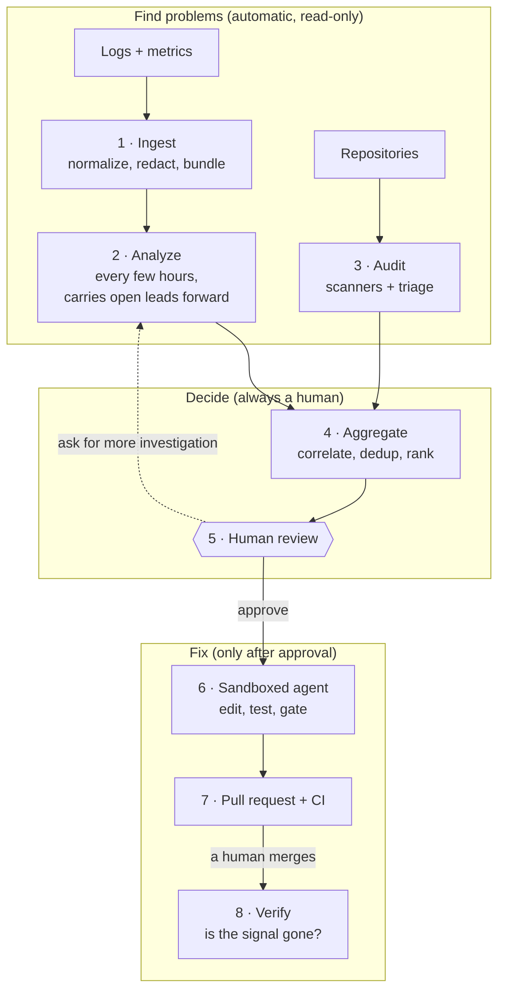

# Opsmith

[](https://github.com/deadboyccc/Opsmith/actions/workflows/ci.yml)
[](LICENSE)

**Opsmith turns production signals and source code into reviewed pull requests.**

It watches your logs, metrics and repositories, links what production shows to what the code
shows, and ranks the result as engineering tasks. When a human approves a task, a sandboxed
coding agent implements it and opens a pull request. After a human merges it, Opsmith checks
that the original problem is actually gone.

It is self-hosted and not tied to a model vendor: it runs offline with built-in rules, with
Claude, or with any OpenAI-compatible endpoint, including local models served by Ollama or
vLLM.

> **Two rules are never broken.** Nothing changes code without a recorded human approval, and
> Opsmith cannot merge. A human always merges.

**Status: pre-1.0.** The whole loop runs and is covered by tests, including adversarial ones
and real-container sandbox tests. It has not been proven in production. See
[what has been tested](#what-has-been-tested) before you point it at something valuable.

## Contents

- [See it work in a minute](#see-it-work-in-a-minute)
- [How it works](#how-it-works)
- [Quickstart](#quickstart)
- [Safety at a glance](#safety-at-a-glance)
- [What has been tested](#what-has-been-tested)
- [Documentation](#documentation)
- [Contributing](#contributing)

## See it work in a minute

You need [uv](https://docs.astral.sh/uv/) and git. No API key, no Docker, no network.

```bash
git clone https://github.com/deadboyccc/Opsmith.git && cd Opsmith
uv sync --all-extras
uv run opsmith demo --dir ./opsmith-demo
```

The demo builds a small repository with a real bug, feeds in logs and metrics, and runs the
entire loop with the offline rule-based provider:

1. **First analysis run:** a burst of timeout errors becomes open **leads** (things worth
   watching).
2. **Second run:** the timeout lead is **confirmed**, using context carried over from the first
   run, and a latency regression is found.
3. **Repository audit:** finds an HTTP call without a timeout on the same line the errors point
   at. The runtime finding and the code finding **merge into one task**.
4. A reviewer **approves** the task. The agent fixes the code and the checks pass.
5. A **pull request** opens, a human merges it, and the task ends **`verified`**.

It prints an admin API key. Use it to look around in the UI:

```bash
OPSMITH_DATA_DIR=./opsmith-demo/data uv run opsmith api
# open http://127.0.0.1:8000/ui and sign in with the admin key the demo printed
```

## How it works

One loop: **observe → analyze → propose → human approves → execute → pull request → verify.**



| # | Stage | What happens | Produces |
|---|---|---|---|
| 1 | **Ingest** | Connectors pull or receive signals. They are normalized, **redacted**, grouped into log templates and metric baselines | Compact **bundles** per service and time window |
| 2 | **Analyze** | Per service, a model of your choice reads the new bundles **plus the open leads from the last run**, and confirms, refutes or carries each lead | **Findings** and updated **leads** |
| 3 | **Audit** | On a schedule: secrets, Python bug and security checks, dependency and license checks, your own policy rules, and external scanners when installed | **Findings** with code locations |
| 4 | **Aggregate** | Findings that point at the same code are merged, checked against open, recently closed and rejected tasks, then scored | Ranked **tasks** |
| 5 | **Review** | A person approves, approves with edits, rejects with a reason, defers, or asks for more investigation | A recorded **review** |
| 6 | **Execute** | An isolated agent edits the checkout and runs the repository's build, lint and test. Opsmith re-runs the checks and blocks unsafe diffs | A tested commit on a new branch |
| 7 | **Pull request** | Opsmith pushes the branch and opens a PR that carries the evidence, the checks and links back to the task | A **PR**; CI is tracked |
| 8 | **Verify** | After the merge, Opsmith watches the original signal | `verified` or `regressed` |

Every arrow is a queued, retried job. A failure never vanishes: it ends as a visible dead job
with a notification, or as a task back in the review queue with a report.

**What makes a task strong** is evidence from both sides. Eighty timeout errors whose stack
traces point at `app/payments.py:10`, plus an audit finding for an HTTP call without a timeout
on that line, become one task with higher confidence than either alone. Every pull request can
be traced back: **PR → execution → review → task → findings → evidence → analysis runs → leads.**

The seven terms above (signal, bundle, lead, finding, task, review, execution), the lifecycles
and the architecture are explained in [docs/ARCHITECTURE.md](docs/ARCHITECTURE.md).

## Quickstart

### Try it on your machine (development)

```bash
uv sync --all-extras
export OPSMITH_SANDBOX_BACKEND=local      # development only: no isolation, local repositories only
export OPSMITH_LOCAL_ROOT=$HOME/opsmith   # the one directory Opsmith may read repos and log files from
uv run opsmith init --tenant dev          # prints an admin API key, shown once
uv run opsmith run                        # API + scheduler + worker in one process
```

Open <http://127.0.0.1:8000/ui>. Describe a project in a TOML file
([`opsmith.example.toml`](opsmith.example.toml) shows every option) and apply it:

```bash
uv run opsmith apply opsmith.toml --tenant dev
```

### Run the full stack (Docker Compose, PostgreSQL)

```bash
cp .env.example .env
echo "POSTGRES_PASSWORD=$(openssl rand -hex 24)" >> .env    # required; there is no default
docker compose up -d --build
docker compose exec api opsmith init --tenant acme --admin "Your Name"
```

This runs the API, a worker, the scheduler and PostgreSQL. To let it **execute** approved tasks
you also choose a sandbox, which is a deliberate step:
[docs/DEPLOYMENT.md](docs/DEPLOYMENT.md#execution-sandbox) explains the options and the
trade-offs, connects a GitHub repository, and shows how to plug in the model you want to use.

### Command line

| Command | Purpose |
|---|---|
| `opsmith demo --dir DIR` | Run the whole loop offline |
| `opsmith init --tenant NAME --admin NAME` | Create the database, a tenant and its first admin |
| `opsmith create-user --tenant NAME --name NAME --role ROLE` | Create a key for a person or a collector |
| `opsmith apply FILE --tenant NAME` | Apply a project configuration file (safe to repeat) |
| `opsmith api` / `scheduler` / `worker` | The three production processes |
| `opsmith run` | All three in one process, for development |

## Safety at a glance

| Guarantee | How it is enforced |
|---|---|
| **No code change without human approval** | One gate checks the approval before the run and again before the push. The approval covers exactly the task the reviewer saw: if its scope changes afterwards, the approval is void |
| **No merge** | The SCM interface has no merge operation |
| **Redaction before any model call** | Signals are redacted when stored and again in the gateway every model call goes through |
| **Untrusted text stays data** | Logs, code and model output are never instructions; model output is schema-checked and invented references are dropped |
| **Isolated execution** | Repository commands run in containers with no network, a read-only root and no capabilities. The agent has no shell and no credentials. The unconfined development sandbox is refused for real repositories |
| **Gated diffs** | Protected paths need an elevated approval or are excluded outright; credential-like values block the PR. The gates run after the last sandboxed command |
| **Least privilege** | Connectors only read. Opsmith pushes only to `opsmith/...` branches and opens PRs |
| **Budgets** | Token and cost caps per run and per project per day; time and iteration caps for the agent |
| **Audit trail** | Every state change and decision is recorded; finished analysis runs are immutable |

Each of these is mapped to its enforcement point and to the tests that try to break it in
[docs/SECURITY.md](docs/SECURITY.md), together with the limits you should know about.

## What has been tested

Honest scope, so you can judge it:

| Area | Evidence |
|---|---|
| The full loop | `tests/test_e2e.py` asserts the specification's acceptance criteria end to end, on SQLite and on PostgreSQL in CI |
| Safety gates | `tests/test_hardening.py` and friends attack each guarantee: approval binding, gate bypasses, sandbox escapes, cross-tenant access, role escalation |
| Docker sandbox | Tested with **real containers** (network, filesystem, capabilities, timeouts, and a full execution). Skipped automatically where Docker is absent |
| Compose deployment | Built and started end to end, including the worker starting sandbox containers through the overlay |
| GitHub, Loki, Prometheus | Tested against **mocked HTTP** only. Not yet exercised against live services in CI |
| Models | The offline rule-based provider drives the tests and the demo. The OpenAI-compatible provider and its coding agent are tested against a scripted endpoint, and were run **live against Ollama** with a small open model (structured output, a pipeline stage, the tool-calling loop). Claude is tested against **fake clients** only |
| Production use | None yet. No load tests, no long-running deployment |

There are no published quality metrics yet (precision of findings, share of pull requests
merged, verified-fix rate). That, a tested connector matrix and schema migrations are the main
open work; see the [changelog](CHANGELOG.md) and
[the review response](docs/REVIEW_RESPONSE.md).

## Documentation

| Read this | For |
|---|---|
| [docs/ARCHITECTURE.md](docs/ARCHITECTURE.md) | How it works: concepts, lifecycles, processes, where the code lives |
| [docs/CONFIGURATION.md](docs/CONFIGURATION.md) | Every project setting, connector, repository and model option |
| [docs/DEPLOYMENT.md](docs/DEPLOYMENT.md) | Installing, the sandbox, GitHub, choosing a model, environment variables, operations |
| [docs/API.md](docs/API.md) | Roles, authentication and the REST API |
| [docs/SECURITY.md](docs/SECURITY.md) | Guarantees, how each is enforced and tested, and what is not protected |
| [ARCHITECTURE_DECISIONS.md](ARCHITECTURE_DECISIONS.md) | Why each design choice was made, and the known limitations |
| [CONTRIBUTING.md](CONTRIBUTING.md), [AGENTS.md](AGENTS.md) | Developing Opsmith: setup, invariants, conventions |
| [CHANGELOG.md](CHANGELOG.md) | What changed |
| [docs/SPECIFICATION.md](docs/SPECIFICATION.md) | The original product specification |
| [docs/independent-project-review.md](docs/independent-project-review.md), [docs/REVIEW_RESPONSE.md](docs/REVIEW_RESPONSE.md) | An independent review of the project, and what was done about it |

## Contributing

```bash
uv sync --all-extras
make check        # what CI runs: ruff, format check, mypy, tests with coverage
```

Start with [CONTRIBUTING.md](CONTRIBUTING.md). It is short.

## License

[MIT](LICENSE)
