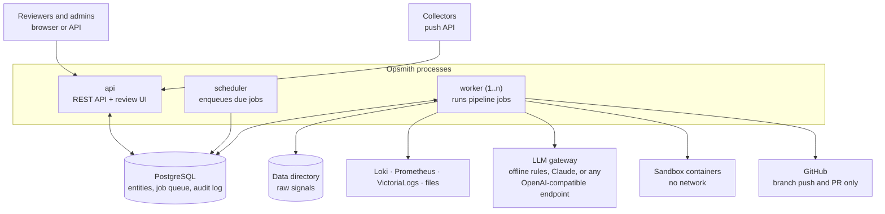
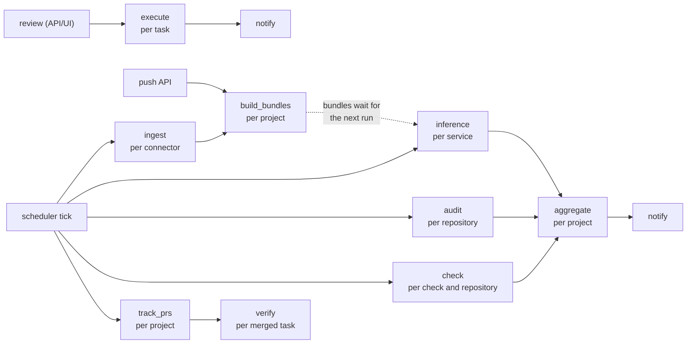
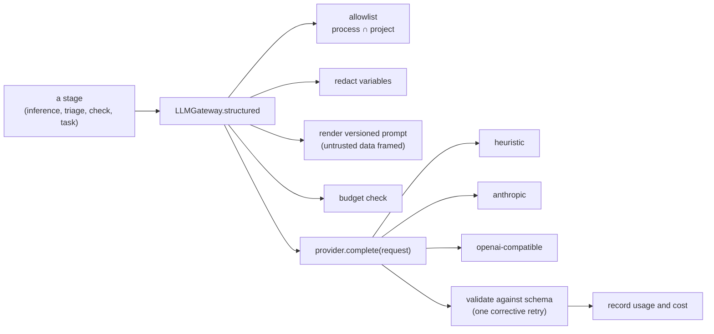

# Architecture for contributors

How Opsmith is built, for people changing it. If you want to understand what it does from the
outside, read [Concepts](../guide/concepts.md) first; this page assumes it. The reasons behind
each design choice are in [ARCHITECTURE_DECISIONS.md](../../ARCHITECTURE_DECISIONS.md), and the
rules that must never be broken are in [AGENTS.md](../../AGENTS.md#invariants-never-break-these).

- [Processes and storage](#processes-and-storage)
- [The job pipeline](#the-job-pipeline)
- [Jobs, schedules and failure handling](#jobs-schedules-and-failure-handling)
- [The model layer](#the-model-layer)
- [The execution path](#the-execution-path)
- [Where the code lives](#where-the-code-lives)
- [Extending Opsmith](#extending-opsmith)

## Processes and storage



Python 3.12, FastAPI, SQLAlchemy 2, Pydantic 2, uv. PostgreSQL in production; SQLite for
development and tests. Every row carries a tenant id, and every query filters on it.

Model access is behind one gateway and a small provider interface. Three providers ship
(`heuristic`, `anthropic`, `openai`), and others can be added as plugins; see
[Models](../guide/models.md).


`platform.Platform` is the composition root: API, worker, scheduler, CLI and tests all build
one, and it wires settings, storage, the gateway, SCM providers and every stage together.

## The job pipeline

Stages never call each other. Each one writes its results and enqueues the next job in the
same transaction, so a crash between two stages loses nothing.



| Job kind | Handler | Enqueued by |
|---|---|---|
| `ingest` | `etl.pipeline.IngestionService.run_connector` | scheduler, manual trigger |
| `build_bundles` | `etl.pipeline.BundleBuilder.build_for_project` | ingest, push |
| `inference` | `inference.orchestrator.InferenceOrchestrator.run` | scheduler, manual trigger |
| `audit` | `audits.runner.AuditRunner.run` | scheduler, manual trigger |
| `check` | `audits.checks.CheckRunner.run` | scheduler, manual trigger |
| `aggregate` | `aggregation.aggregator.Aggregator.run` | inference, audit, check, manual trigger |
| `execute` | `executor.service.ExecutionService.execute` | an approving review |
| `track_prs` | `tracking.PRTracker.run` | scheduler, manual trigger |
| `verify` | `tracking.Verifier.run` | PR tracking, after a merge |
| `notify` | `notifications.handle_notify_job` | anything that calls `notifications.notify` |

The mapping lives in `Platform.handlers()`.

## Jobs, schedules and failure handling

Every stage is a job in a database-backed queue.

- **Idempotent enqueue.** Each job has a key derived from the work it stands for, so enqueueing
  twice yields one job. Follow-up work is enqueued in the same transaction as the state it
  depends on.
- **Retries.** A failing job is retried with exponential backoff. When its attempts are used up
  it becomes `dead`: audited, notified, visible in the UI, and retryable by an admin.
- **Leases.** A worker holds a job under a lease that it renews while it is alive. A slow job is
  never handed to a second worker; a dead worker's job is picked up after the lease expires.
- **Waiting is not failing.** A handler can ask to be run later (for example while another task
  touches the same files) without using up an attempt.
- **Schedules** live in the database: an interval or a five-field cron expression per connector,
  service, repository, check and project. The slot is part of the job key, so several schedulers or
  repeated ticks never double-enqueue, and missed slots collapse into one run. A schedule that
  cannot be computed is disabled and audited rather than stopping the others.

Nothing is dropped silently. Every failure ends in one of four visible places: a retry, a dead
job with a notification, a task back in review with a report, or a finding marked suppressed
with a reason.


Implementation notes:

- `queue.enqueue` is idempotent on `idempotency_key` (a unique column). Keys must be
  deterministic for the logical unit of work, for example `execute:<task>:<review>`.
- A handler raises `queue.RetryLater` to wait without using an attempt, and
  `queue.PermanentFailure` when retrying cannot help.
- `Worker._execute` runs the handler with a heartbeat thread that renews the lease. Long work
  (clones, agents, checks) runs outside database transactions; see `ExecutionService`.
- Work that must not overlap is serialized where the shared thing lives. One aggregation per
  project and one analysis per service take a row lock (`db.SERIALIZE`: `FOR NO KEY UPDATE`
  on PostgreSQL, which excludes another holder but not the inserts that reference the row).
  Audits and checks of one repository share one advisory file lock next to the repository's
  checkout (`audits.runner.checkout_lock`), because the shared thing there is a directory; a
  second run is deferred.
- The API commits a request's transaction when its handler returns, before the response is
  sent (`deps.SessionDep` is a function-scoped dependency), so a failed commit is never
  answered with a 2xx.
- State changes go through `audit_log.transition_task` / `transition_lead`, which enforce the
  state machines and write the audit trail. A flush guard makes finished `InferenceRun` and
  `AuditRun` rows immutable.

## The model layer

Nothing in the pipeline talks to a model vendor directly.



- A provider implements `llm.base.LLMProvider`: a `name` and
  `complete(ProviderRequest) -> ProviderResponse`. It receives the rendered prompt and the
  schema, and returns data plus token usage. A call that was billed but unusable (refused,
  truncated) raises an `LLMError` carrying that usage, so the gateway can still record it.
- `HeuristicProvider` implements every stage with rules and reads the structured variables
  instead of the prompt text. It is why the whole system runs offline.
- Prompts live in `llm/prompts.py` with an id and a version that every run records. Bump the
  version when the text changes.
- The coding agents (`executor/agents.py`) do not go through the gateway, because they hold a
  conversation with tools rather than one structured call. They share one tool dispatcher
  (`dispatch_tool`) and one task brief (`task_brief`), and the execution service writes their
  usage to the same ledger.

`tests/test_provider_parity.py` runs the acceptance scenario through the OpenAI-compatible HTTP
path and requires the same outcome as the offline run. A change that breaks one provider's path
shows up there.

## The execution path

`executor.service.ExecutionService` is the most security-sensitive code. Read
[Concepts: From approval to pull request](../guide/concepts.md#from-approval-to-pull-request)
for the sequence, then note how it is implemented:

- `assert_approved` is the single gate. It compares `review.approval_scope_digest` with the
  digest stored on the approving review.
- `sandbox_policy_error` refuses the `local` backend for non-local repositories.
- After the checkout, `.git` is copied to a directory outside the workspace. Every later
  `gitutil.run_git(..., git_dir=...)` call uses that copy, with hooks and fsmonitor disabled.
- `_diff_gates` runs after the platform's own check run. `gitutil.worktree_changes` and
  `staged_added_lines` parse git's NUL-delimited output.
- `scm.base.check_pushable` restricts pushes to `opsmith/...` branches.

Each of these has a test that tries to defeat it; [Security](../guide/security.md) lists them.

## Where the code lives

| Path under `src/opsmith/` | Responsibility |
|---|---|
| `platform.py` | Wires everything together and maps job kinds to handlers. Start reading here |
| `models.py`, `schemas.py` | Database entities; settings and model-output schemas |
| `migrations/` | Schema migrations (Alembic), applied when a process starts |
| `connectors/`, `etl/` | Signal sources (Loki, Prometheus, VictoriaLogs, files, push); normalize, redact, store, bundle |
| `redaction.py` | Secret and PII detectors, shared by ingestion, the gateway and the diff gate |
| `inference/orchestrator.py` | Chained analysis runs and the lead lifecycle |
| `audits/` | Analyzers, external tool wrappers, the audit runner, and checks (`checks.py`, ADR-019) |
| `aggregation/` | Correlation, dedup, suppression, scoring, task drafting |
| `review.py` | The human review gate and the approval scope digest |
| `executor/` | Sandboxes, the confined workspace, coding agents, the execution service, PR text |
| `scm/` | GitHub and local git providers. No merge operation, by design |
| `tracking.py` | PR and CI tracking; post-merge verification |
| `llm/` | The gateway every model call goes through, prompts, pricing, and the providers (`heuristic`, `anthropic`, `openai`) |
| `queue.py`, `scheduler.py` | The job queue and schedules |
| `audit_log.py` | The audit trail, the task and lead state machines, run immutability |
| `localfs.py`, `config.py`, `protection.py` | Host-file confinement; process settings and credential references; protected paths |
| `api/`, `ui/` | REST API (`/api/v1`) and the server-rendered UI (`/ui`) |
| `cli.py`, `demo.py` | The `opsmith` command; the offline end-to-end scenario |
| `gitutil.py` | The only place git is invoked: safe config, the trusted git dir, NUL-delimited parsing |
| `db.py` | Engine and sessions, `utcnow`, `new_id`, the `SERIALIZE` row lock |
| `security.py` | Tenants, users, roles and API keys (stored as SHA-256) |
| `notifications.py` | The notification outbox; delivery is a `notify` job |
| `provenance.py`, `dashboard.py` | A task's provenance chain; dashboard figures and the task funnel |
| `storage.py`, `observability.py`, `configfile.py` | The object store; JSON logs and `/metrics`; `opsmith apply` |

## Extending Opsmith

Three kinds of plugin can be added without changing Opsmith, as a Python package that declares
an entry point. Built-in ones use the same mechanism through a `@register` decorator.

| What | Entry-point group | Implement |
|---|---|---|
| A signal source | `opsmith.connectors` | A subclass of `connectors.base.LogConnector` or `MetricConnector` with `fetch(start, end, cursor) -> FetchResult` |
| An audit analyzer | `opsmith.analyzers` | A subclass of `audits.base.Analyzer` (or `audits.external.ExternalTool` with a pure `parse()`), declaring `name` and `audit_types` |
| A model provider | `opsmith.llm_providers` | A callable `(settings) -> provider`, where the provider has `name` and `complete(request)` |

```toml
# pyproject.toml of your plugin package
[project.entry-points."opsmith.connectors"]
datadog_logs = "my_package.datadog:DatadogLogConnector"

[project.entry-points."opsmith.llm_providers"]
my_gateway = "my_package.llm:make_provider"
```

Rules for each:

- **Connector.** Read-only. Return records in `[start, end)`; skip and count records you cannot
  parse (`FetchResult.skipped`) instead of raising. If you could not read the whole window,
  return `cursor["last_end"]` set to where you stopped. Validate URLs with
  `connectors.base.validate_base_url`. Test with `httpx.MockTransport`.
- **Analyzer.** Return `RawFinding`s with a stable `rule_id`, a path and a line. Never execute
  repository code. Isolate failures per file. Mask secrets in snippets.
- **Provider.** Send only what is in the request; it is already redacted. Report token usage.
  Raise `LLMRefusal` / `LLMOutputError` with `.usage` set for billed-but-unusable responses.

Changes inside Opsmith:

- **A new model stage:** add an output schema to `schemas.py`, a prompt to `llm/prompts.py`,
  and a matching branch in `HeuristicProvider` so the stage works offline. Call it through
  `LLMGateway.structured`.
- **A new task state:** extend `TASK_TRANSITIONS`, the status chips in
  `ui/templates/macros.html`, `dashboard.FUNNEL`, and add an ADR entry.
- **A new setting:** add it to `schemas.ProjectSettings` with a bound, document it in
  [Configuration](../guide/configuration.md), and add it to `opsmith.example.toml`.
- **Anything users can see:** `make docs` fails until it is documented. Environment variables
  go in [Deployment](../guide/deployment.md) and `.env.example`; API endpoints in
  [API](../guide/api.md); notification events, connector types and audit types in
  [Configuration](../guide/configuration.md); analyzers and task or lead states in
  [Concepts](../guide/concepts.md); model providers and coding agents in
  [Models](../guide/models.md); CLI commands in the README; job kinds in the table on this
  page.
- **A schema change:** change `models.py`, then write a revision against a scratch database
  that is at the newest revision:

  ```bash
  export OPSMITH_DATABASE_URL=sqlite:////tmp/opsmith-migrations.db
  uv run alembic upgrade head
  uv run alembic revision --autogenerate --rev-id 0002 -m "add tasks.owner"
  uv run alembic upgrade head && uv run alembic check   # "No new upgrade operations detected."
  ```

  Number revisions in sequence and read what was generated: autogenerate misses renames
  (it drops and adds) and server defaults, and a new non-null column on an existing table
  needs a default or a data step. Never edit a released revision. Run
  `tests/test_migrations.py` on PostgreSQL as well (see [Testing](testing.md)), and add an
  *Upgrade notes* entry to the changelog. Details are in ADR-002.
