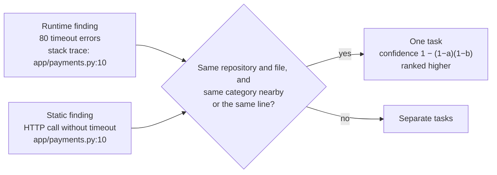
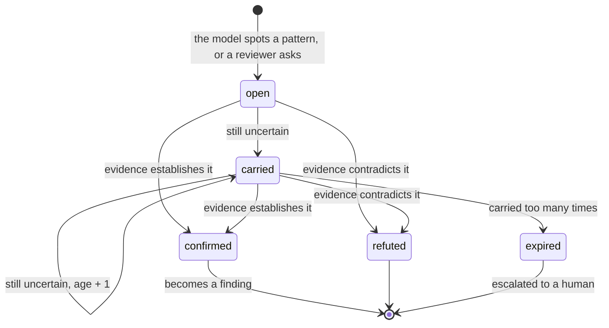
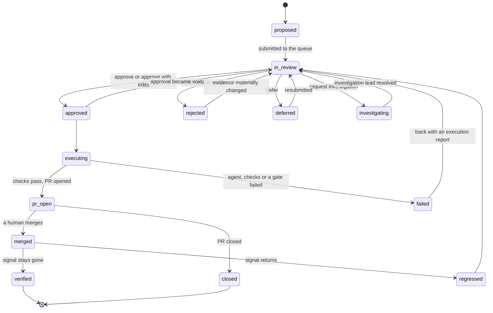

# Concepts

How Opsmith thinks: the seven terms it uses, what each stage of the pipeline does, and how
leads and tasks move through their lifecycles. Read this to understand what you see in the UI.
If you want to change Opsmith itself, the internals are in
[development/architecture.md](../development/architecture.md).

- [Key concepts](#key-concepts)
- [The pipeline, stage by stage](#the-pipeline-stage-by-stage)
- [Lifecycles](#lifecycles)
- [From approval to pull request](#from-approval-to-pull-request)
- [What never gets lost](#what-never-gets-lost)

## Key concepts

Seven terms carry the whole system.

| Concept | What it is | Example |
|---|---|---|
| **Signal** | A normalized, redacted log event or metric point | `ERROR upstream timeout after 30000ms` |
| **Bundle** | A compact summary of one service over one time window: log templates and metric anomalies, with references to the raw data. Sized to fit a model's context | 80 timeout errors, p95 latency up 590% |
| **Lead** | An open question carried from one analysis run to the next until it is confirmed, refuted or expired | "Timeouts are recurring. Confirm next window." |
| **Finding** | A problem with evidence, from analysis (runtime) or from an audit or a [check](checks.md) (static) | `httpx.post` without timeout at `app/payments.py:10` |
| **Task** | One or more correlated findings, ranked P0 to P3, with an approach and acceptance criteria | "Add a timeout to the payment gateway call" |
| **Review** | A human decision on a task, recorded with identity and time | approved by *Riley Reviewer* |
| **Execution run** | One sandboxed attempt to implement an approved task and open a PR | branch `opsmith/performance/…`, PR #1 |

Everything is traceable in one direction:

**PR → execution run → review → task → findings → evidence (bundles, raw events, audit results) → analysis runs → leads.**

The task page in the UI and `GET /api/v1/tasks/{id}/provenance` show that chain.

## The pipeline, stage by stage

### 1. Ingest

A **connector** fetches signals for a time window (Loki, VictoriaLogs, Prometheus, files) or
receives them through the push API. Each record is normalized to a common schema, mapped to a
service, and **redacted** before it is stored. Records that cannot be parsed are skipped and
counted, not allowed to block the rest.

Bundles are then built per service:

- Log lines are grouped into **templates** (variable parts masked, similar lines clustered),
  each with counts, severities, sample messages, stack-trace locations and references to the
  raw events.
- Metrics get **features**: mean and percentiles, a baseline from a look-back window, the
  change against it, and a direction-aware anomaly flag (a latency rise and a success-rate drop
  are both bad).

Raw data stays in the object store. Bundles refer to it by key and line.

### 2. Analyze (chained runs)

On an interval per service (six hours by default), the configured model receives the new
bundles **and a summary of the open leads**. It answers with:

- **findings** for problems the evidence supports,
- one **update per lead**: confirm, refute or carry,
- **new leads** for patterns that need another window to decide.

This is what gives the analysis memory without unbounded context: each run sees a bounded
summary of open leads, never the history of earlier runs.

The model's output is untrusted. It must match a schema; updates for unknown leads are ignored;
evidence references that were not in the input are dropped and the finding's confidence is
reduced. Each run is stored as an immutable record with its inputs, prompt version, model,
output and cost. A run that fails still records what it spent.

### 3. Audit

On a schedule per repository (nightly by default; a full audit at least weekly, changed files
only in between), analyzers examine a checkout:

| Analyzer | Finds |
|---|---|
| `secrets` | Credentials and private keys in files (values are masked in the finding). A value that only refers to a secret is not one: `${DB_PASSWORD}`, `$PASS`, `$(cat ...)`, a `{{ template }}`, or a variable or call in program code (`password = form.password`). A literal still is, including the default in `${X:-...}` and a value inside a string or a comment |
| `python-ast` | Bare `except` and swallowed exceptions, mutable default arguments, `eval`, `yaml.load`, `subprocess` with a shell, SQL built from strings, HTTP calls without a timeout, queries inside loops |
| `dependencies` | Unpinned dependencies; known vulnerabilities through OSV when enabled |
| `compliance` | A missing license or one outside your allowlist; your own policy rules |
| `coverage-gaps` | Modules without tests. Off by default: add `coverage` to the repository's `audit_types` |
| `ruff`, `semgrep`, `gitleaks`, `trivy`, `osv-scanner` | Used automatically when the tool is installed on the worker; recorded as unavailable otherwise |

A triage pass then filters likely false positives and calibrates confidence. A finding that
triage drops is kept with the reason, never deleted.

**Checks** add reviews of your own. A check is an instruction in plain words ("review this
code for missing authorization checks"), with the files it covers and a cron. A model carries
it out, and every problem it reports must quote the file it names, or it is discarded. The
problems that are kept become findings like the analyzers' and go on to aggregation. See
[Checks](checks.md).

### 4. Aggregate

New findings are grouped, compared with existing tasks, and scored.



| A new finding matches… | Result |
|---|---|
| an **open** task | Its evidence is added to that task; no new task |
| a task that is **approved or executing** | It waits. A task a human has approved is never changed underneath them; the evidence is attached once the execution is over |
| a task **closed or merged recently** (14 days by default) | Suppressed, with the reason recorded |
| a **rejected** task | Suppressed, unless the evidence *materially* changed: higher severity, a new kind of evidence, or two to three times stronger evidence, depending on why it was rejected |
| nothing | A new task, sent for review |

An audit re-reporting the same defect is the same evidence again, not more evidence. Every
runtime finding is a new occurrence.

The score combines severity, confidence, evidence strength, how often and how recently it was
seen, how many services are affected, whether runtime and static evidence agree, the category
and the estimated effort. It maps to a priority from P0 to P3.

### 5. Review

Tasks wait in the review queue. A reviewer can:

| Decision | Effect |
|---|---|
| Approve | Queues the execution |
| Approve with edits | Changes title, approach, priority, paths, branch name or similar first, then approves |
| Reject (with a reason code) | Closes it and suppresses the same issue in future |
| Defer | Parks it; it can be resubmitted |
| Request investigation | Opens a lead with the reviewer's question for the next analysis run; the task returns to review with the answer |

A task that touches **protected paths** needs more: `elevated` paths need an admin who
explicitly acknowledges it; `excluded` paths cannot be approved at all.

### 6 to 8. Execute, open a pull request, verify

Covered in [From approval to pull request](#from-approval-to-pull-request). After a human
merges the PR, a verification job watches the task's original signals. If the log template or
metric anomaly does not come back, and a later audit no longer reports the static finding (for
a finding from a [check](checks.md), a later run of that check), the task becomes `verified`;
otherwise `regressed`, which returns it to review. A task merged again
after a regression is verified again. If no post-merge signals or audit arrive within 48 hours
of the delay, the verification job fails (a dead job, with a notification); retry it from the
*Jobs* page once data has arrived.

## Lifecycles

### Lead



A lead the model does not mention is carried, not dropped. One carried more than
`lead_max_carry` times expires and is escalated with a notification.

### Task



Every transition goes through one function and is written to the audit log with who did it.

## From approval to pull request

```mermaid
sequenceDiagram
    actor Reviewer
    participant UI as Opsmith API / UI
    participant Queue as Job queue
    participant Exec as Executor
    participant Box as Sandbox
    participant Git as GitHub

    Reviewer->>UI: Approve task
    UI->>Queue: Record review with a digest of the task's scope, enqueue "execute"
    Queue->>Exec: Run job
    Exec->>Exec: Gate 1: human approval, scope unchanged, protected paths, sandbox policy
    Exec->>Exec: Fresh checkout, no remote, no credentials. Snapshot git metadata outside it
    Exec->>Box: Agent edits files and runs the configured checks
    Exec->>Box: Opsmith re-runs build, lint and test itself
    Exec->>Exec: Gate 2: changed files vs protected paths, added lines vs credential patterns
    Exec->>Exec: Commit from the trusted snapshot (hooks off)
    Exec->>Exec: Gate 3: approval re-checked, scope still unchanged
    Exec->>Git: Push branch opsmith/…, open PR with evidence and provenance
    Git-->>Exec: CI status (polled)
    Reviewer->>Git: Review and merge (humans only)
    Exec->>Exec: Post-merge verification: verified or regressed
```

Points worth knowing:

- **The agent has six tools and nothing else:** list files, read a file, write a file, replace
  text in a file, run one of the configured checks by name, and finish. No shell, no network,
  no credentials. Three agents ship, all behind that same tool set: `heuristic` (deterministic
  fixes for a handful of rules, so the loop works offline), `claude`, and `openai` (any model
  behind an OpenAI-compatible endpoint that supports tool calling).
- **The checks are the repository's own commands** (`build_command`, `lint_command`,
  `test_command`), set by an admin. They run only in the sandbox.
- **The gates run after the last sandboxed command,** so what is checked is exactly what is
  committed.
- **A failure of any kind** (agent gave up, checks failed, a gate blocked, the sandbox is
  unavailable, the approval is void) returns the task to the review queue with a report and a
  notification. Up to two attempts are made when a failure looks transient.
- **Concurrency is bounded per project,** and tasks that touch the same files wait for each
  other.

## What never gets lost

Every stage is a queued job that is retried when it fails. A failure always ends somewhere you
can see it:

- a **retry**, with backoff;
- a **dead job** with a notification, once its retries are used up (*Jobs* in the UI; an admin
  can retry it);
- a **task back in the review queue** with a report, when an execution fails or is refused;
- a **finding marked suppressed** with the reason, when it is filtered out or is a duplicate.

[Operations](operations.md) covers what to watch and what to do about each.
