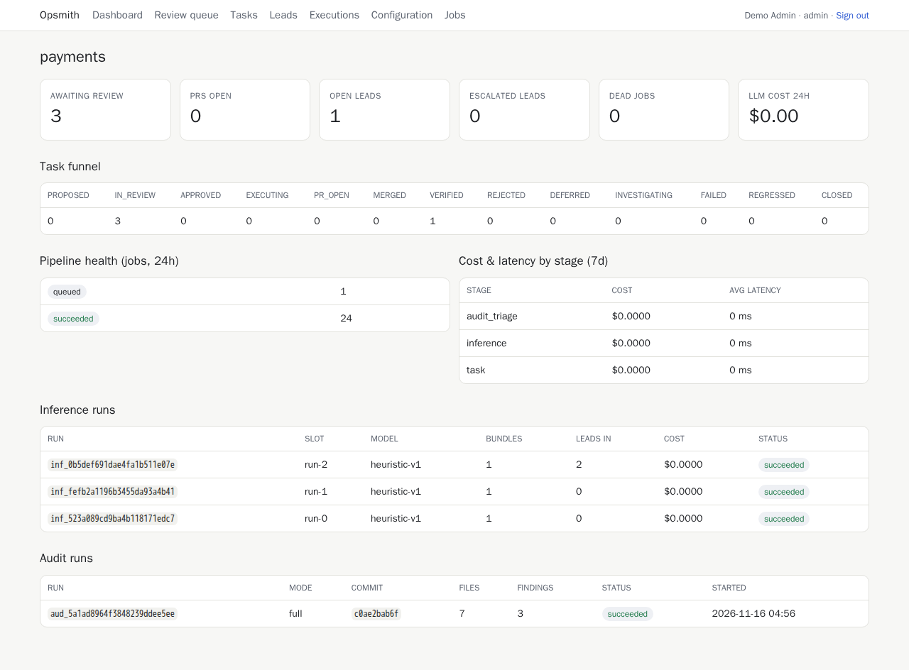
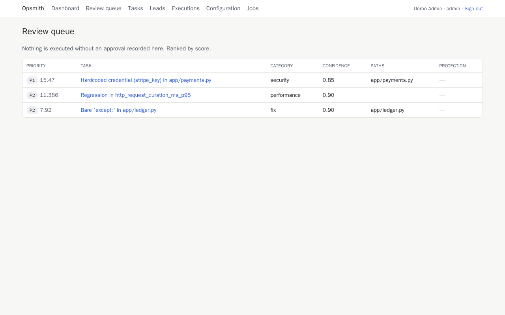
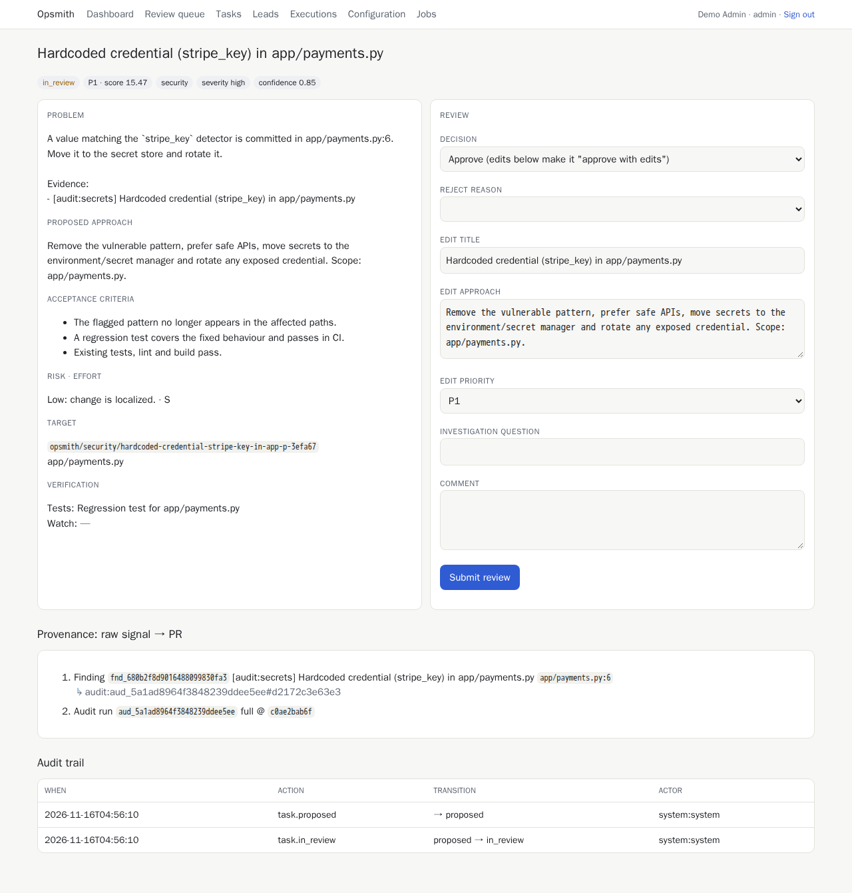
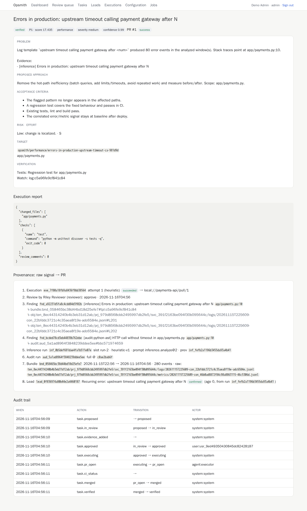
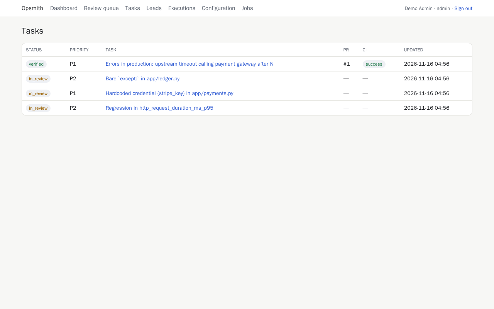
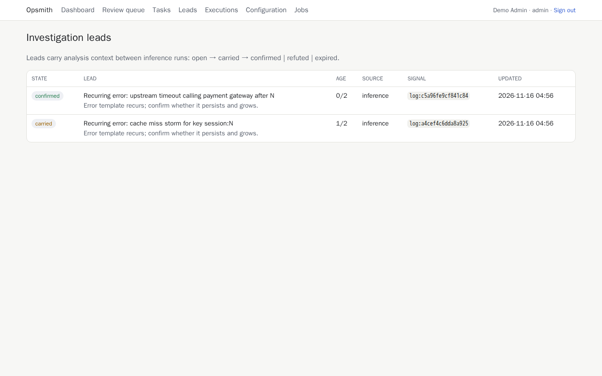
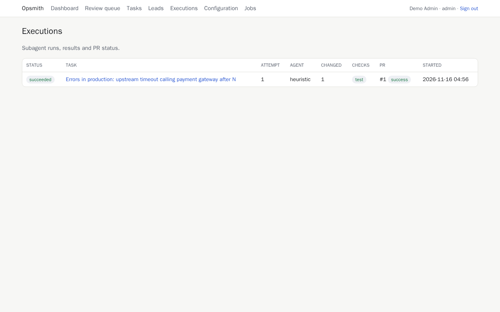
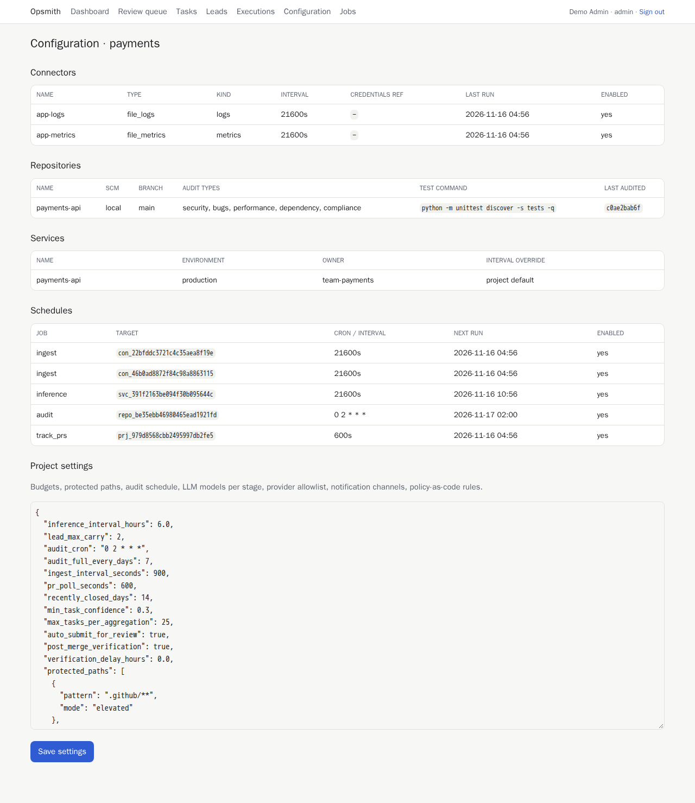
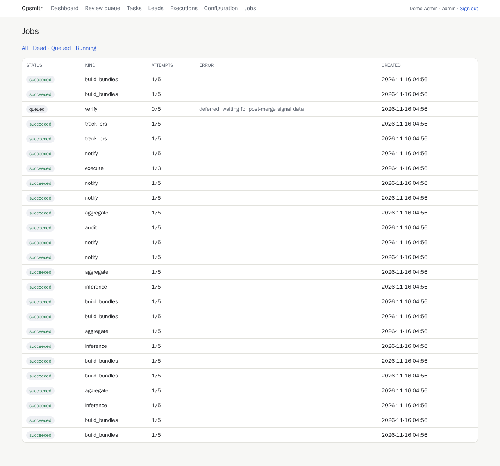
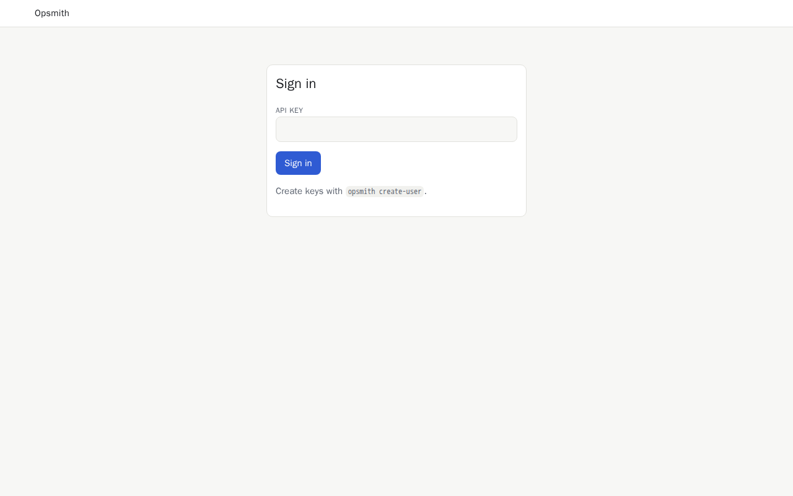

# A tour of the UI

These are screenshots of the review UI after running the offline demo
(`uv run opsmith demo`). **Everything in them is made up:** the demo generates its own
`payments-api` repository, logs and metrics, and its own people (*Demo Admin*,
*Riley Reviewer*). No real system, credential or person appears.

To click through the same pages yourself:

```bash
uv run opsmith demo --dir ./opsmith-demo
OPSMITH_DATA_DIR=./opsmith-demo/data uv run opsmith api
# open http://127.0.0.1:8000/ui and sign in with the admin key the demo printed
```

## Dashboard

The state of one project at a glance: what is waiting for a person, the task funnel, pipeline
health, cost per stage, and the latest analysis and audit runs.



## Review queue

Tasks waiting for a human decision, highest score first. Nothing is executed until someone
approves it here.



## A task waiting for review

The problem, the proposed approach and the acceptance criteria on the left; the decision form
on the right. A reviewer can approve, edit and approve, reject with a reason, defer, or ask
for more investigation. Below is where the task came from.



## A task that went all the way

This task merged a runtime finding (80 timeout errors whose stack traces point at
`app/payments.py:10`) with a code finding (an HTTP call without a timeout on that line). It was
approved, fixed by the agent, opened as a pull request, merged by a human and then verified.

The **provenance** section traces it back step by step: execution, review, findings, analysis
and audit runs, the bundle and its raw data, and the lead that started it. The **audit trail**
lists every state change and who made it.



## All tasks



## Leads

Open questions the analysis carries from one run to the next until the evidence confirms or
refutes them.



## Executions

Each attempt to implement an approved task: the agent, the branch, the checks and the result.



## Configuration

Connectors, repositories, services and schedules, and the project settings as JSON (editable by
admins), including the project's [checks](checks.md).



## Jobs

Every pipeline stage is a queued job. Failed jobs are retried; ones that run out of attempts
show up under *Dead* and can be retried by an admin.



## Sign in

The UI signs in with the same API key the REST API uses.



## How the pictures and videos are made

The screenshots are generated by [`scripts/ui_screenshots.py`](../../scripts/ui_screenshots.py),
which runs the demo, serves the UI and captures each page. Re-run it after changing a template:

```bash
uvx --from playwright playwright install chromium         # once
uv run --with playwright python scripts/ui_screenshots.py
```

The one-minute [demo video](../images/demo.mp4) (and the GIF in the README) is recorded by
[`scripts/demo_video.py`](../../scripts/demo_video.py). It holds the demo at its approval
step, approves the task through the review form in a real browser, and records the task
through to `verified`:

```bash
uvx --from playwright playwright install chromium         # once
uv run --with playwright --with imageio-ffmpeg python scripts/demo_video.py
```

The 30-second vertical [reel](../images/reel.mp4) (1080 x 1920, for phones and social media)
is rendered frame by frame from an HTML storyboard by
[`scripts/reel_video.py`](../../scripts/reel_video.py), using these screenshots and the
mascot. Every run gives the same video:

```bash
uv run --no-project --with playwright --with imageio-ffmpeg python scripts/reel_video.py
```

Both scripts record silent video. Both videos have an original instrumental track, composed
and synthesized by [`scripts/soundtrack.py`](../../scripts/soundtrack.py) (no voice, nothing
licensed), so run it after recording either one:

```bash
uv run --no-project --with numpy --with imageio-ffmpeg python scripts/soundtrack.py
```
